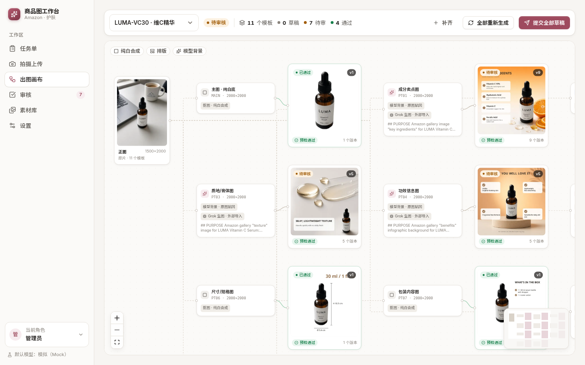
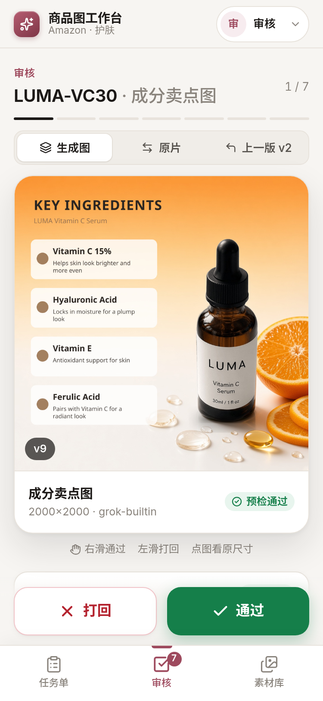
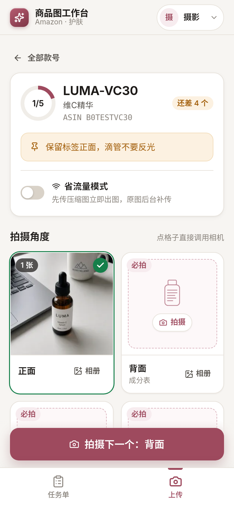
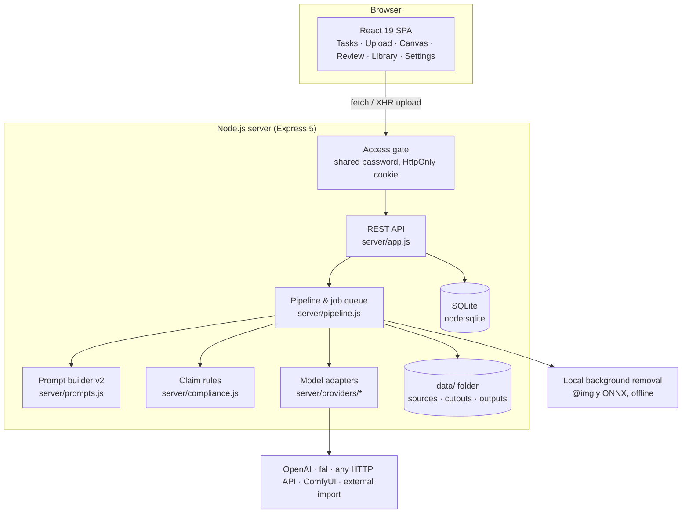

# Ecom Workbench · 商品图工作台

**English** | [简体中文](README.zh-CN.md)

A self-hosted product-image workbench for **Amazon sellers** (skincare template pack included).
A photographer shoots on a phone and uploads; the system automatically lays out an **infinite canvas** that turns each
photo into a full Amazon image set — pure-white MAIN image, ingredient / texture / benefit infographics, lifestyle
scenes and A+ modules. Designers refine prompts per node, a reviewer approves or rejects on their phone, and approved
images land in an asset library that exports Amazon-ready file names.


> The product itself is **never redrawn** by the model: the original cut-out is pasted back pixel-for-pixel, and all
> text is rendered by the layout engine — so labels, logos and colors stay true to the photo.

| Infinite canvas (desktop) | Review on a phone | Shoot & upload on a phone |
|---|---|---|
|  |  |  |

## Features

- **Phone-first upload** – per-SKU shoot tasks with angle slots (front / back / 45° / texture / package…), camera
  capture, data-saver mode (compressed preview first, original later), retry on flaky networks, automatic archive naming.
- **Automatic template pack** – 11 Amazon templates per SKU (MAIN, PT01–PT07, A+ header/banner/tile).
  - MAIN is deterministic: local background removal → pure white RGB 255, product fills 85 %, 2000×2000. No model involved.
  - Generative templates ask the model **only for the background**; the product cut-out is pasted back with edge
    harmonisation, model-alignment (fixes "ghost" duplicates) and a contact shadow; text is overlaid by code.
- **Infinite canvas** (React Flow) – source → template → output nodes, per-node prompt editor (sectioned v2 prompts),
  per-node model switcher, version history, regenerate / recomposite-only.
- **AI precheck** – size, zoomability, sRGB/JPEG, file size, pure-white edges, 85 % fill, source quality, and a
  15-rule FDA / Amazon claim checker ("treats eczema", "boosts collagen", "SPF", prices/promos…).
- **Review flow** – swipe to approve / reject with reason tags; rejected items go back to the designer with the
  previous version shown side by side on resubmission.
- **Asset library & export** – one-click ZIP with `ASIN.MAIN.jpg`, `ASIN.PT01.jpg`, `APLUS/ASIN.APLUS_HEADER_970x600.jpg`
  and a `manifest.csv`.
- **Pluggable model adapters** – OpenAI GPT Image, fal.ai, any HTTP API (no code), local ComfyUI workflows,
  an external/manual import queue, and a free mock. Cost ledger per call.
- **Mobile-ready** – every page except the canvas works on a phone.

## Quick start

Requirements: **Node.js ≥ 22.13** (uses the built-in `node:sqlite`). No database server, no GPU needed.

```bash
git clone https://github.com/Bin0754/ecom-workbench.git && cd ecom-workbench
cp .env.example .env          # optional: set WB_ACCESS_PASSWORD, model keys, …
npm install                   # also installs web/
npm run build && npm start    # → http://localhost:5180
npm run seed                  # (in another terminal) demo SKUs + photos, generated with the free mock channel
```

Development with hot reload: `npm run dev` (API on :5180 with `--watch`, Vite on :5173).

Docker:

```bash
cp .env.example .env && docker compose up -d   # data persists in the "workbench-data" volume
```

Out of the box no API key is needed: new nodes use the free **mock** channel, so the whole flow runs instantly with
placeholder backgrounds. For real images, enable a model channel in Settings and set e.g. `WB_DEFAULT_PROVIDER=openai`
(or `comfyui`, `http`, or `grok` for the free external-import workflow).

## Workflow

```mermaid
flowchart LR
  A[Admin / designer<br/>creates shoot task<br/>SKU · ASIN · copy · angles] --> B[Photographer<br/>phone upload per angle]
  B --> C[Auto canvas<br/>cut-out + 11 templates]
  C --> D{Model channel}
  D -->|mock / OpenAI / fal / HTTP / ComfyUI| E[Background]
  D -->|external import| E
  E --> F[Composite: paste product back,<br/>align, shadow, text overlay]
  F --> G[AI precheck<br/>size · white bg · 85% · claims]
  G --> H[Designer refines<br/>prompt · model · copy · regenerate]
  H --> I[Submit for review]
  I --> J{Reviewer<br/>on phone}
  J -->|reject + reasons| H
  J -->|approve| K[Asset library<br/>Amazon ZIP export]
```



Roles (switch in the top-right; see [Security](SECURITY.md) — roles are a workflow aid, not authentication):

| Role | Pages |
|---|---|
| Photographer | Tasks, Upload |
| Designer | Tasks, Canvas, Library |
| Reviewer | Review, Library |
| Admin | Everything + Settings (channels, template prompts, claim rules, cost ledger) |

## Architecture



Tech: React 19 + Vite, `@xyflow/react` (canvas), `lucide-react`, Express 5, `node:sqlite`, `sharp` (compositing),
`@imgly/background-removal-node` (cut-out), `multer`, `archiver`.

## Model channels

| Channel | Key | Notes |
|---|---|---|
| `grok` – external import | none | Server writes a job (full prompt + layout reference). Generate the background in **any** tool — e.g. Grok, ChatGPT, Midjourney — and import it in the node inspector, via `POST /api/grok/import/:outputId`, or `scripts/grok_jobs.py`. Originally built for Grok Bot's built-in image generation. Free. |
| `mock` (default) | none | Procedural placeholder backgrounds with a MOCK badge. For demos/tests. |
| `openai` | `OPENAI_API_KEY` | GPT Image edits endpoint; optional `OPENAI_BASE_URL` for compatible gateways. Token-based cost. |
| `fal` | `FAL_KEY` | GPT Image 2.5 on fal.ai queue API, mask-guided edit. |
| `http` | `WB_HTTP_*` | Any synchronous JSON API, configured in Settings (body template + result path). |
| `comfyui` | none | Your local ComfyUI with an API-format workflow. |

Keys are read **only from environment variables**, never stored in the DB or shown in the UI, and a paid channel can't
be enabled until its key is present. Details and how to write your own adapter: **[docs/ADAPTERS.md](docs/ADAPTERS.md)**.
Prompt templates and variables: **[docs/PROMPTS.md](docs/PROMPTS.md)**.

## Configuration

All settings are environment variables — see [.env.example](.env.example). The most important:

| Variable | Default | |
|---|---|---|
| `PORT` / `HOST` | `5180` / `0.0.0.0` | |
| `WB_DATA_DIR` | `./data` | SQLite DB, originals, cut-outs, outputs |
| `WB_ACCESS_PASSWORD` | *(empty = no gate)* | **Set this** for anything reachable beyond your machine |
| `WB_TRUST_PROXY` | *(off)* | Set behind a reverse proxy so rate limiting sees real IPs |
| `WB_DEFAULT_PROVIDER` | `mock` | Channel for new canvas nodes (must be enabled in Settings) |

## Scripts

| Command | |
|---|---|
| `npm run dev` | API (watch) + Vite dev server |
| `npm run build` / `npm start` | Production build / run (reads `.env`) |
| `npm test` | Unit + API smoke tests (`node:test`, mock adapters, no network, no keys) |
| `npm run lint` / `npm run format` | ESLint / Prettier |
| `npm run seed` | Demo SKUs (server must be running) |
| `./start.sh` | Build + background start with PID file; keys only from `.env` |

## Amazon / compliance disclaimer

The templates, size rules and the claim checker encode common Amazon image guidelines and FDA cosmetic-vs-drug claim
guidance **as of 2026, for convenience only**. They are not legal advice and are not affiliated with or endorsed by
Amazon or the FDA. Marketplace rules change; always verify against current Seller Central policies and have claims
reviewed by a qualified person. You are responsible for the images and claims you publish. Generated images may be
subject to the terms of the model provider you use.

The demo data uses a fictional brand ("LUMA") and intentionally contains a few non-compliant claims so you can see the
precheck flag them.

## Contributing

Issues and PRs are welcome — see [CONTRIBUTING.md](CONTRIBUTING.md). Security issues: [SECURITY.md](SECURITY.md).

## License

[MIT](LICENSE)
