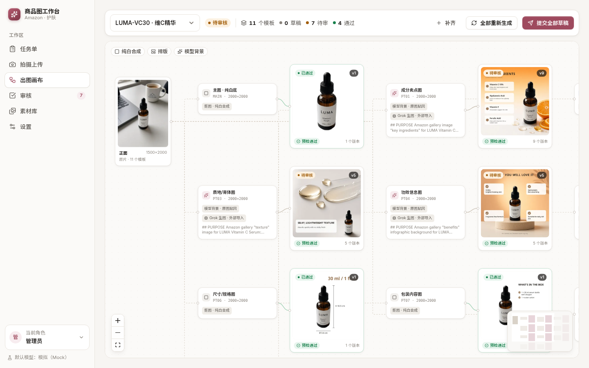
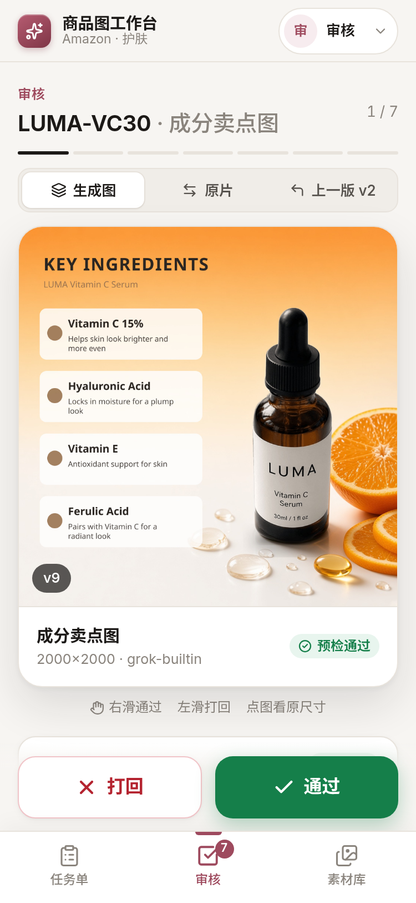
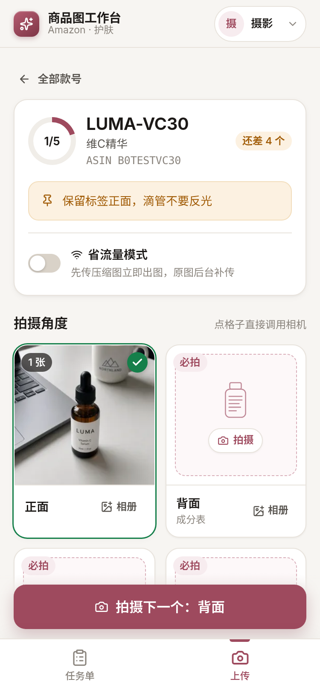
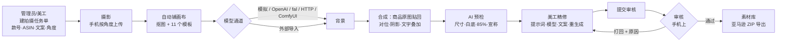

# Ecom Workbench · 商品图工作台

[English](README.md) | **简体中文**

一个可自部署的**亚马逊商品图工作台**（内置护肤品模板包）。
摄影用手机拍完直接上传，系统自动铺好**无限画布**，把每张原片做成整套亚马逊图片：纯白底主图、成分 / 质地 / 功效信息图、
场景图和 A+ 模块；美工在画布上逐个节点精修提示词，审核在手机上通过或打回，通过的图进入素材库，一键导出符合亚马逊命名的文件。


> 商品本身**不让模型重画**：抠图后的原图商品逐像素贴回，所有文字由排版引擎叠加——标签、logo、颜色与原片一致。

| 无限画布（电脑） | 手机审核 | 手机拍摄上传 |
|---|---|---|
|  |  |  |

## 功能

- **手机优先的上传**：按款号建拍摄任务单与角度槽位（正面 / 背面 / 45° / 质地 / 包装…），直接调用相机，省流模式（先传压缩图出图、原图后补），弱网自动重试，自动归档命名。
- **自动模板包**：每个款号 11 个亚马逊模板（MAIN、PT01–PT07、A+ 头图 / 横幅 / 方块）。
  - 主图走确定性流程：本地抠图 → 纯白 RGB 255，商品占 85%，2000×2000，不经过生图模型。
  - 生成类模板只让模型出**背景**；原图商品贴回（边缘融合、按模型对位修复重影、接触阴影），文字由程序叠加。
- **无限画布**（React Flow）：原片 → 模板 → 结果节点；每个节点可编辑分段提示词（v2）、单独切换模型、查看版本历史、重新生成或只重新合成。
- **AI 预检**：尺寸、可放大、sRGB/JPEG、文件大小、四边纯白、85% 占比、原片质量，以及 15 条 FDA / 亚马逊宣称规则（"treats eczema"、"boosts collagen"、SPF、价格促销等）。
- **审核流**：右滑通过、左滑打回并选原因标签；打回的图回到美工，重新提交时审核能对比上一版。
- **素材库与导出**：一键 ZIP，`ASIN.MAIN.jpg`、`ASIN.PT01.jpg`、`APLUS/ASIN.APLUS_HEADER_970x600.jpg` + `manifest.csv`。
- **可插拔模型通道**：OpenAI GPT Image、fal.ai、任意 HTTP API（无需写代码）、本地 ComfyUI 工作流、外部导入队列、免费模拟通道；每次调用记成本流水。
- **移动端适配**：除画布外所有页面都能在手机上用。

## 快速开始

需要 **Node.js ≥ 22.13**（使用内置 `node:sqlite`）。不需要数据库服务器，不需要 GPU。

```bash
git clone https://github.com/Bin0754/ecom-workbench.git && cd ecom-workbench
cp .env.example .env          # 可选：设置访问密码 WB_ACCESS_PASSWORD、模型密钥等
npm install                   # 会同时安装 web/ 的依赖
npm run build && npm start    # → http://localhost:5180
npm run seed                  # （另开终端）导入演示款号和照片，用免费的模拟通道出图
```

开发热更新：`npm run dev`（API 在 5180 端口自动重启，Vite 在 5173）。

Docker：

```bash
cp .env.example .env && docker compose up -d   # 数据保存在 workbench-data 卷
```

开箱不需要任何 API key：新节点默认用免费的**模拟**通道，立刻就能走通完整流程（占位背景）。要出真实图片，在设置里启用模型通道，并设置如 `WB_DEFAULT_PROVIDER=openai`（或 `comfyui`、`http`，或免费的外部导入 `grok`）。

## 工作流程



| 角色 | 可用页面 |
|---|---|
| 摄影 | 任务单、拍摄上传 |
| 美工 | 任务单、画布、素材库 |
| 审核 | 审核、素材库 |
| 管理员 | 全部 + 设置（模型通道、模板提示词、合规规则、成本流水） |

角色在右上角切换，只用于分工，**不是身份认证**（见 [SECURITY.md](SECURITY.md)）。

## 架构

架构图见英文版 [README](README.md#architecture)。代码结构：

```
server/
  index.js        启动入口         app.js       REST API（createApp）
  config.js       环境变量配置     gate.js      访问密码门禁
  db.js           SQLite 表结构    pipeline.js  抠图→合成→预检、任务队列、外部导入
  prompts.js      v2 提示词构建    templates.js 模板包（尺寸/构图/版式）
  compliance.js   宣称合规规则     exporter.js  亚马逊命名、manifest
  providers/      模型适配器：mock · grok(外部导入) · openai · fal · http · comfyui
web/src/          React 前端（pages/ 下每页一个文件，i18n.js 语言字典）
test/             node:test 测试（单元 + API 冒烟）
```

## 模型通道

| 通道 | 密钥 | 说明 |
|---|---|---|
| `grok` 外部导入 | 无 | 服务器只写出图任务（完整提示词 + 参考构图）。用**任意**工具（Grok、ChatGPT、Midjourney…）生成背景后，在画布节点里「导入背景图」，或调 `POST /api/grok/import/:outputId`、`scripts/grok_jobs.py`。最初为 Grok Bot 内置生图设计。免费。 |
| `mock` 模拟（默认） | 无 | 程序画占位背景，带 MOCK 角标，用于演示和测试。 |
| `openai` | `OPENAI_API_KEY` | GPT Image 编辑接口；可用 `OPENAI_BASE_URL` 接兼容网关。按 token 计费。 |
| `fal` | `FAL_KEY` | fal.ai 上的 GPT Image 2.5，队列 API + 遮罩编辑。 |
| `http` 通用 | `WB_HTTP_*` | 任意同步 JSON 接口，在设置页配置请求体模板和结果路径即可。 |
| `comfyui` | 无 | 本地 ComfyUI，粘贴 API 格式工作流。 |

密钥**只从环境变量读取**，不入库、网页不显示也不能填写；没设置密钥的付费通道无法启用。
适配器开发见 **[docs/ADAPTERS.md](docs/ADAPTERS.md)**，提示词模板见 **[docs/PROMPTS.md](docs/PROMPTS.md)**。

## 常用配置

完整列表见 [.env.example](.env.example)。

| 变量 | 默认 | |
|---|---|---|
| `PORT` / `HOST` | `5180` / `0.0.0.0` | |
| `WB_DATA_DIR` | `./data` | SQLite、原片、抠图、输出图 |
| `WB_ACCESS_PASSWORD` | 空 = 不启用门禁 | 只要不是本机自用，**务必设置** |
| `WB_TRUST_PROXY` | 关 | 放在反向代理后面时设置，登录限流才能拿到真实 IP |
| `WB_DEFAULT_PROVIDER` | `mock` | 新节点默认通道（需在设置里启用） |

## 脚本

| 命令 | |
|---|---|
| `npm run dev` | API（自动重启）+ Vite 开发服务器 |
| `npm run build` / `npm start` | 构建 / 运行（读取 `.env`） |
| `npm test` | 单元 + API 冒烟测试（模拟通道，不联网、不用密钥） |
| `npm run lint` / `npm run format` | ESLint / Prettier |
| `npm run seed` | 导入演示数据（需先启动服务） |
| `./start.sh` | 构建并后台启动（PID 文件）；密钥只从 `.env` 读取 |

## 亚马逊 / 合规免责声明

模板、尺寸规则和宣称检查只是按 2026 年常见的亚马逊图片规范和 FDA 化妆品/药品宣称区分**整理的辅助工具**，不构成法律意见，与亚马逊、FDA 无任何关联或背书。平台规则会变，上架前请以 Seller Central 最新政策为准，并由专业人员审核宣称。发布的图片和宣称由使用者自行负责；生成图片可能受所用模型服务条款约束。

演示数据使用虚构品牌「LUMA」，并故意包含几条不合规宣称，用来演示预检拦截效果。

## 参与贡献

欢迎提 Issue 和 PR，见 [CONTRIBUTING.md](CONTRIBUTING.md)；安全问题见 [SECURITY.md](SECURITY.md)。

## 许可证

[MIT](LICENSE)
