# User guide

**English** | [简体中文](GUIDE.zh-CN.md)

A step-by-step walkthrough for everyone on the team. Each role uses the device that suits it: the **admin** and
**designer** on a computer, the **photographer** and **reviewer** on a phone.

- [0. Install and first start](#0-install-and-first-start) (whoever runs the server)
- [1. Admin: password, model channels, templates](#1-admin-password-model-channels-templates)
- [2. Photographer: shoot and upload on a phone](#2-photographer-shoot-and-upload-on-a-phone)
- [3. Designer: refine on the canvas](#3-designer-refine-on-the-canvas)
- [4. Reviewer: approve or reject on a phone](#4-reviewer-approve-or-reject-on-a-phone)
- [5. Asset library: Amazon export](#5-asset-library-amazon-export)
- [6. FAQ & troubleshooting](#6-faq--troubleshooting)

> The UI is available in English and Chinese. It follows your browser language; switch it any time with the
> **language selector** (sidebar bottom on a computer, top bar on a phone) or by adding `?lang=en` / `?lang=zh` to the URL.

---

## 0. Install and first start

You need **Node.js 22.13 or newer** (`node -v`). Nothing else: no database server, no GPU, no API key.

```bash
git clone https://github.com/Bin0754/ecom-workbench.git
cd ecom-workbench
npm ci                      # installs the server and the web app
cp .env.example .env        # your local settings (never committed)
```

Open `.env` and set a password — everybody on your network can reach the app otherwise:

```ini
WB_ACCESS_PASSWORD=choose-a-long-password
```

Then build and start:

```bash
npm run build
npm start                   # → http://localhost:5180
```

Want demo data to click through? In a **second terminal** (while the server runs):

```bash
npm run seed                # 3 demo SKUs with photos; images are generated by the free mock channel
```

During development use `npm run dev` instead (API restarts on changes, web app with hot reload on
http://localhost:5173).

**Docker** (alternative): `cp .env.example .env`, set the password, then `docker compose up -d --build`. Data lives in
the `workbench-data` volume. Open http://localhost:5180.

**Open it on a phone:** the phone must be on the same Wi-Fi/LAN as the computer running the server. Find the
computer's LAN IP — macOS: `ipconfig getifaddr en0`, Windows: `ipconfig` (IPv4 Address), Linux: `hostname -I` — and
open `http://<that-ip>:5180` on the phone, e.g. `http://192.168.1.23:5180`. Tip: "Add to Home Screen" makes it feel
like an app.

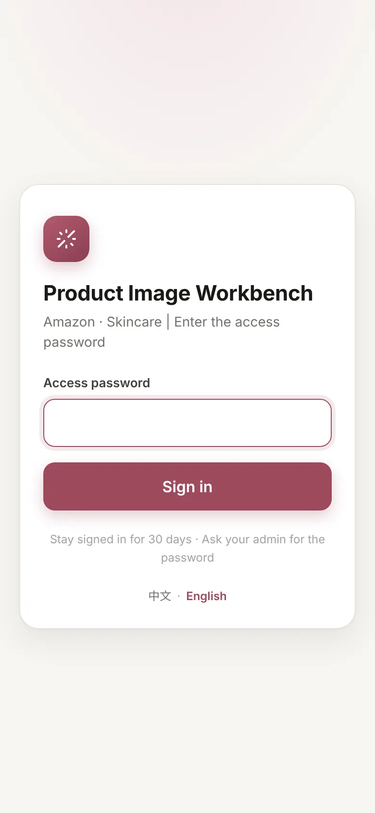

Everyone signs in with the shared password once; the login lasts 30 days. Then pick your **role** (top-right on a
phone, bottom-left on a computer). Roles only decide which pages you see — they are a workflow aid, not user
accounts (see [SECURITY.md](../SECURITY.md)).

| Role | Uses | Pages |
|---|---|---|
| Admin | computer | everything + Settings |
| Photographer | phone | Shoot tasks, Upload |
| Designer | computer | Shoot tasks, Canvas, Library |
| Reviewer | phone | Review, Library |

---

## 1. Admin: password, model channels, templates

### 1.1 Access password

Set `WB_ACCESS_PASSWORD` in `.env` (step 0) and restart. Changing it signs everybody out. Behind a reverse proxy
(nginx, Caddy, Cloudflare Tunnel…) also set `WB_TRUST_PROXY=1` and, with HTTPS, `WB_COOKIE_SECURE=1`.

### 1.2 Model channels

**Settings → Model channels** lists every image channel. Out of the box only **Mock** (free, placeholder
backgrounds — good for learning the workflow) and **Grok (external import)** (free, you generate the background
yourself in any tool) are enabled.

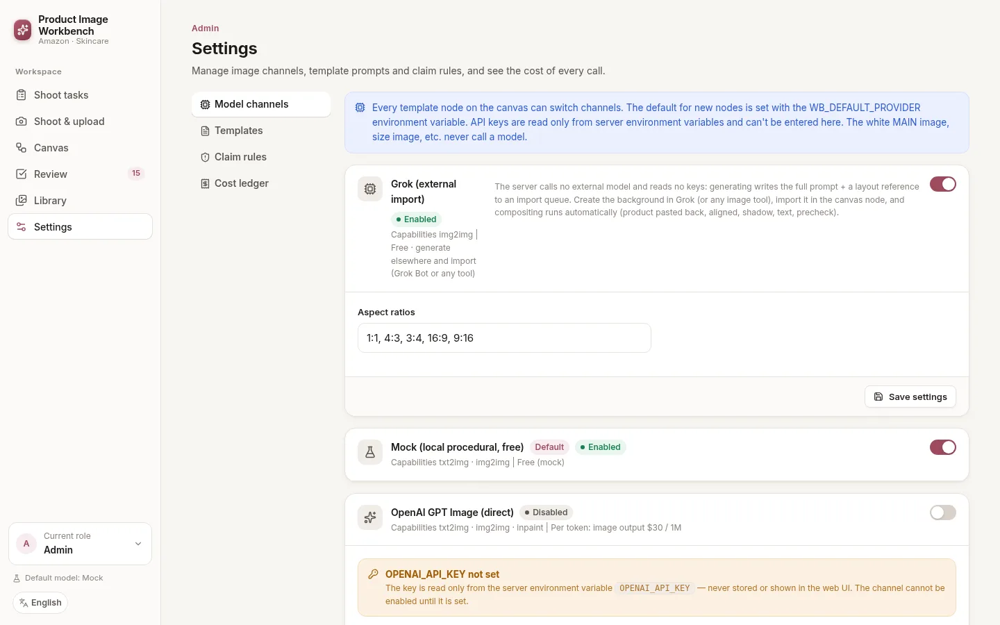

Important rules:

- **API keys are never typed into the web page.** They are read only from environment variables (`.env`) when the
  server starts. A paid channel can't be enabled until its key is present.
- The channel for **new** canvas nodes is `WB_DEFAULT_PROVIDER` (default `mock`). Designers can switch any single
  node to another enabled channel.
- The pure-white MAIN image and the size/what's-in-the-box layouts never call a model.

**Connect OpenAI with your own key**

1. Add to `.env`: `OPENAI_API_KEY=sk-...` (optional: `OPENAI_BASE_URL=...` for an OpenAI-compatible gateway).
2. Optional: `WB_DEFAULT_PROVIDER=openai` so new nodes use it.
3. Restart the server (`npm start` again, or `docker compose up -d` for Docker).
4. Settings → *OpenAI GPT Image (direct)* now shows "OPENAI_API_KEY detected" → switch it on, pick model and quality,
   **Save settings**.

Every call is recorded in **Settings → Cost ledger** with tokens and USD.

**Local ComfyUI (your own GPU, no per-image cost)**

1. In ComfyUI enable *Dev mode* and export your workflow with **Save (API Format)**.
2. Settings → *Local ComfyUI*: paste the JSON into *Workflow JSON*, set *Base URL* (default
   `http://127.0.0.1:8188`).
3. Map the inputs as `nodeId.field`: *Prompt node* e.g. `6.text` (required), *Input image node* e.g. `10.image`
   (a LoadImage node — the layout reference is uploaded to it), optional *Mask node*, *Seed node* e.g. `3.seed`.
4. Save, switch the channel on, and select it on a canvas node (or set `WB_DEFAULT_PROVIDER=comfyui`).

**Any other image API (generic HTTP, no code)**

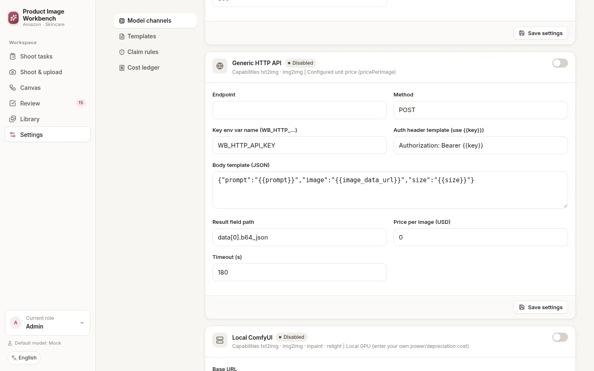

1. Put the key in `.env` under a name that starts with `WB_HTTP_`, e.g. `WB_HTTP_API_KEY=...`, and restart.
2. Settings → *Generic HTTP API*: fill *Endpoint*, keep *Key env var name* = `WB_HTTP_API_KEY`, *Auth header
   template* = `Authorization: Bearer {{key}}` (write `{{key}}`, never the key itself).
3. *Body template* is the JSON you send, with variables like `{{prompt}}`, `{{image_data_url}}`, `{{size}}`.
   *Result field path* tells where the image is in the response, e.g. `data[0].b64_json` or `images[0].url`.
4. Save, switch on, use it on a node. All fields are explained in [ADAPTERS.md](ADAPTERS.md).

**Grok / external import (free, manual)** — the server writes the prompt and a layout reference; you generate the
background in Grok, ChatGPT, Midjourney… and import it (see [3.4](#34-external-import)).

### 1.3 Template prompts and claim rules

**Settings → Templates** holds the default prompt of each generative template, split into sections (Purpose,
Product, Scene & set, Camera, Lighting, …). Edits apply to new generations. `{variables}` such as `{name}` or
`{hero_ingredients}` are filled from the SKU data — see [PROMPTS.md](PROMPTS.md).

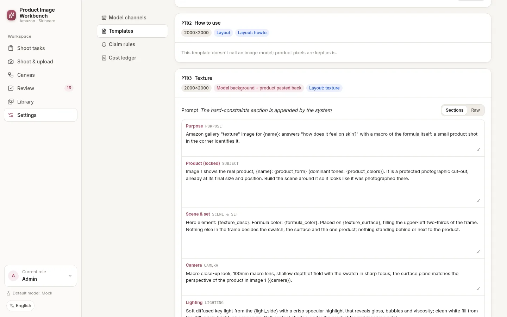

**Settings → Claim rules** shows the FDA/Amazon wording rules the precheck uses (read-only; a hint, not legal
advice).

---

## 2. Photographer: shoot and upload on a phone

### 2.1 The shoot task (created by an admin or designer)

On a computer: **Shoot tasks → New shoot task**. Required: **SKU** and **English product name**. Fill the **ASIN** so
the export uses Amazon file names. Pick the **required angles**, and write the English copy (ingredients, benefits,
how-to-use, box contents) — the layout engine puts it on the images and the precheck checks it.

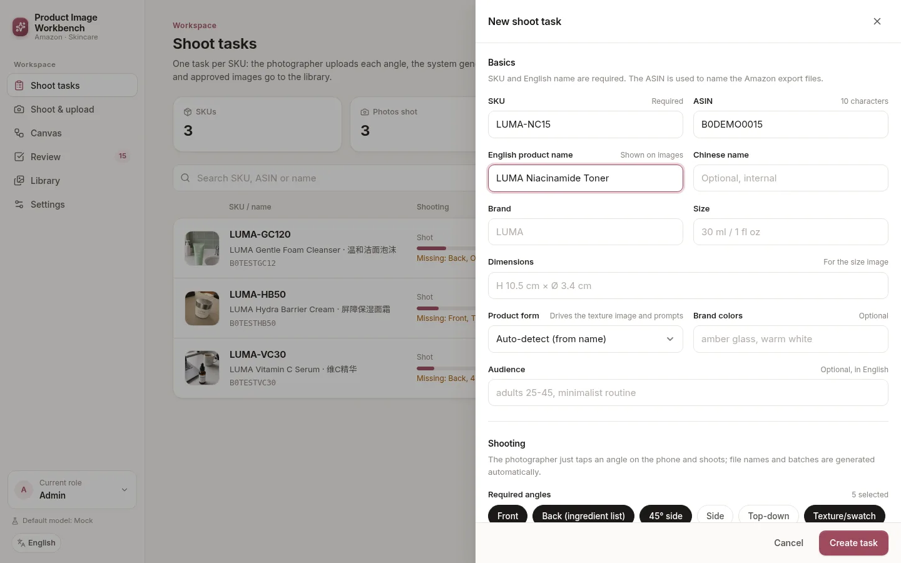

### 2.2 Shooting

1. On the phone, open the app, role **Photographer** → **Shoot tasks** → **Shoot & upload** on a SKU.
2. Each tile is an **angle slot**. Tap a tile to open the camera, or **Album** to pick existing photos. "Required"
   tiles are what the task asks for; the big button at the bottom always jumps to the next missing angle.
3. The ring at the top shows progress. Warnings (too small, too dark, blurry) appear under the photo — reshoot if
   asked.
4. **Data saver** (on by default on slow networks): a compressed copy is uploaded first so generation starts right
   away, and the full original follows in the background.

| Task list | Angle slots |
|---|---|
| 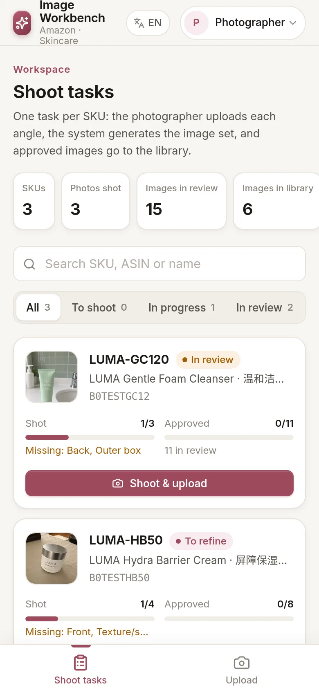 | 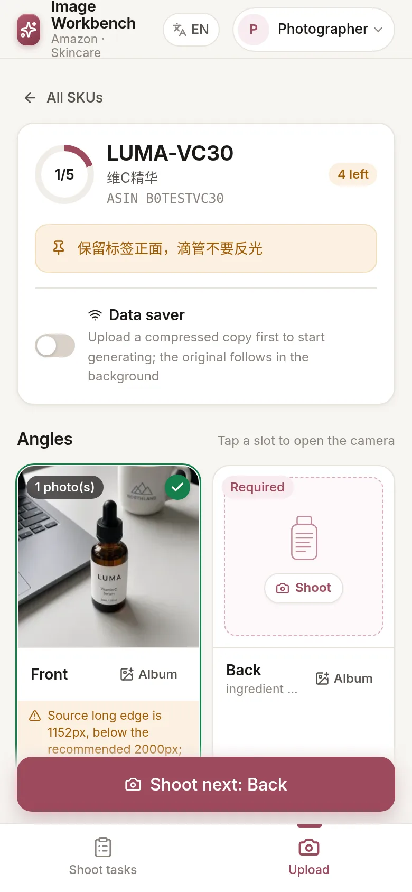 |

**Bulk upload** (computer or phone): name files `SKU_angle_nn.jpg`, e.g. `LUMA-VC30_front_01.jpg`,
`LUMA-VC30_back_01.jpg` (angles: front, back, 45, side, top, texture, package, inbox, detail). Unrecognised files go
to *Unsorted*, where you choose the angle by hand. Originals are archived read-only with an automatic name.

As soon as a photo arrives, the system cuts out the product and lays out the canvas — nothing else to do.

---

## 3. Designer: refine on the canvas

Use a computer (the canvas is hidden on phones). Role **Designer** → **Canvas** → pick a SKU.

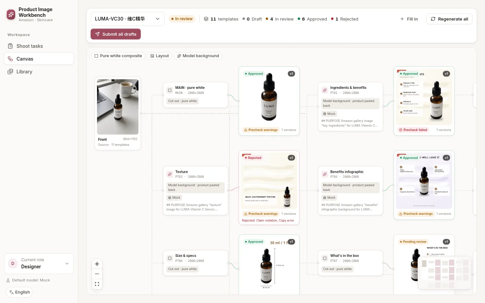

Left: the source photos. Middle: one **template node** per Amazon image (MAIN, PT01–PT07, A+). Right: the latest
**result** with status and precheck badge. Drag nodes freely; positions are saved. The legend shows the three kinds:
*pure white composite* (MAIN, no model), *layout* (no model) and *model background* (the model draws only the
background; the real product is pasted back pixel-for-pixel and all text is rendered by code).

Toolbar: **Fill in** adds missing template nodes for newly uploaded angles, **Regenerate all**, **Submit all drafts**.

### 3.1 Edit a node

Click a template node to open the inspector:

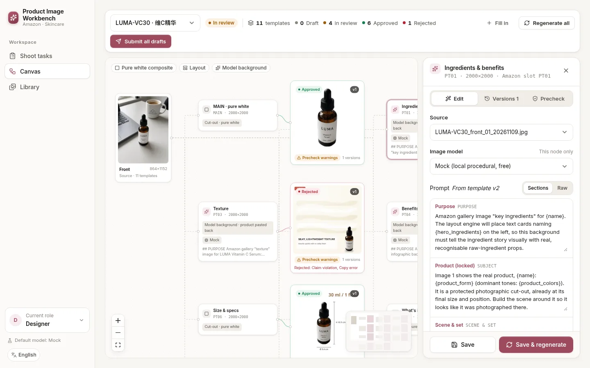

- **Source** – which photo this template uses.
- **Image model** – channel for this node only.
- **Prompt** – edit section by section (or *Raw*). Changes here override the template for this node only. The
  *Full prompt sent to the model* preview shows the final text with variables filled in.
- **Palette / Scene / Texture / Mood / Quality** – quick overrides; leave empty for automatic values.
- **Image copy** – headline, subheadline and items rendered on the image.

**Save** keeps the changes; **Save & regenerate** creates a new version.

### 3.2 Versions and precheck

The **Versions** tab lists every version (v1, v2…) with its status, channel, duration, the exact prompt used and the
review history. **Precheck** shows size, zoom, file size, pure-white edges, 85 % fill and claim checks.

### 3.3 Submit for review, handle rejections

When a version looks right: **Versions → Submit vN for review** (or **Submit all drafts** in the toolbar). Rejected
results turn red on the canvas with the reviewer's reasons:

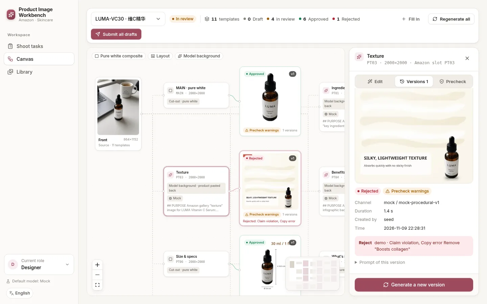

Fix the prompt or copy, **Save & regenerate**, then submit the new version. The reviewer sees the previous version
next to it.

### 3.4 External import

If a node uses **Grok (external import)**, generating creates a version in status *Awaiting import*:

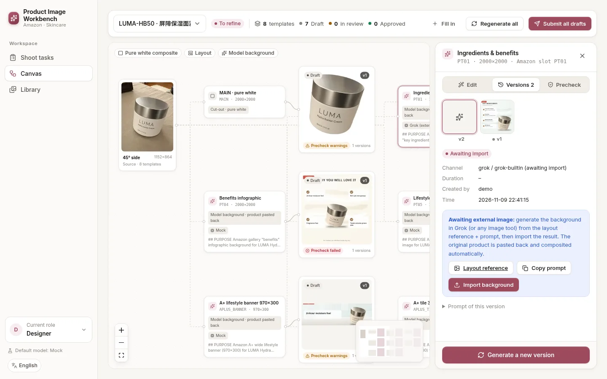

1. **Layout reference** – download the image showing where the product sits.
2. **Copy prompt** – paste it with the reference into Grok, ChatGPT, Midjourney or any image tool.
3. **Import background** – upload the generated image. The system crops it, pastes the original product back,
   aligns it, adds shadows and text, and runs the precheck.

(Also scriptable: `POST /api/grok/import/<outputId>` or `python3 scripts/grok_jobs.py`.)

---

## 4. Reviewer: approve or reject on a phone

Role **Reviewer** → **Review**. One card per image:

| Review card | Reject reasons |
|---|---|
| 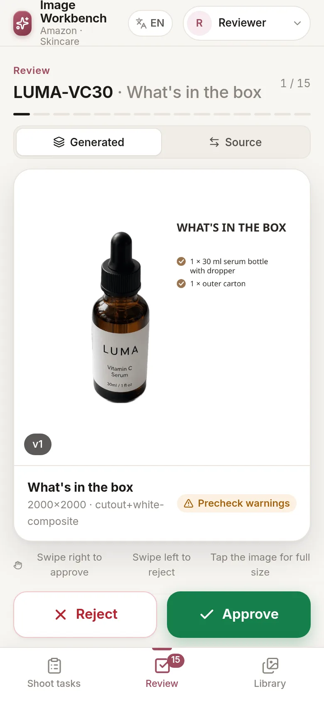 | 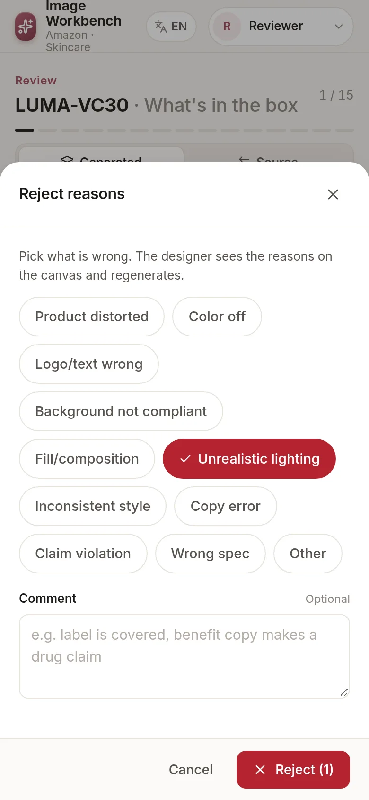 |

- **Swipe right** or tap **Approve**; **swipe left** or tap **Reject**.
- Rejecting requires at least one **reason** (product distorted, color off, claim violation…) plus an optional
  comment. The designer sees them on the canvas.
- Switch between **Generated**, **Source** and (on resubmissions) **Previous** to compare. Tap the image for full
  size.
- **AI precheck** lists anything to check. Approving an image with a failed check asks for confirmation.
- **Approve all for this SKU** approves every image of the SKU that has no failed precheck item.

---

## 5. Asset library: Amazon export

**Library** keeps only approved final versions.

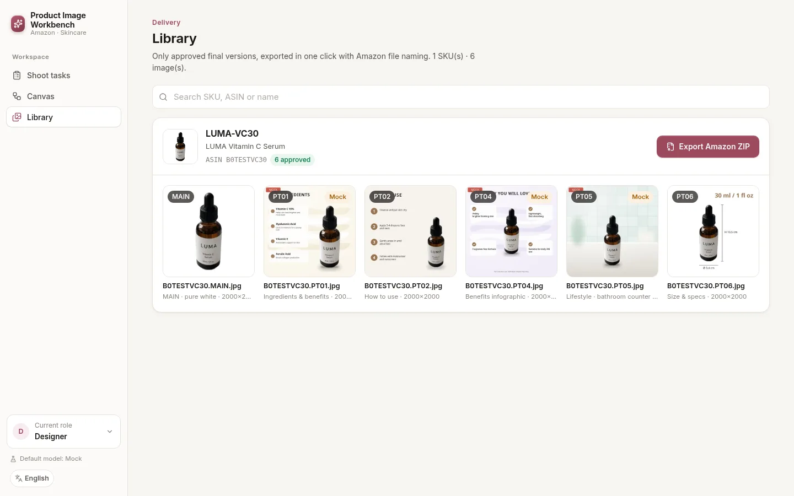

**Export Amazon ZIP** downloads everything for a SKU, named the way Seller Central expects:

```
B0XXXXXXXX.MAIN.jpg
B0XXXXXXXX.PT01.jpg … PT07.jpg
APLUS/B0XXXXXXXX.APLUS_HEADER_970x600.jpg
manifest.csv
```

Without an ASIN the SKU is used and the ZIP contains `README_MISSING_ASIN.txt` — rename before uploading. Images can
also be downloaded one by one (works on a phone too).

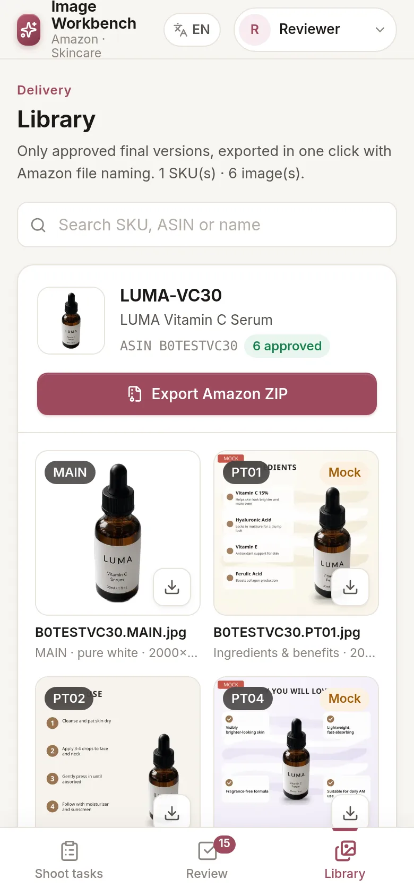

---

## 6. FAQ & troubleshooting

**The phone can't open the site.**
Both devices must be on the same network (guest Wi-Fi often isolates devices). Use the computer's LAN IP, not
`localhost`, and include the port: `http://192.168.x.x:5180`. Allow Node.js through the computer's firewall
(Windows asks on first start; macOS: System Settings → Network → Firewall). `HOST` must stay `0.0.0.0` (default).
In Docker, check that port 5180 is published (`docker compose ps`).

**Generation seems stuck ("Generating" forever).**
Open the node's **Versions** tab: an error is shown there and in the server log. Mock takes seconds; paid models
30–120 s; ComfyUI depends on your GPU (`timeoutSec` in the channel settings). At most `WB_CONCURRENCY` (default 2)
jobs run in parallel, others queue. If the server restarted, interrupted jobs are marked failed — click **Generate a
new version**. A node in *Awaiting import* is not stuck: it waits for you to import a background (3.4).

**My API key doesn't take effect.**
Keys are read only from environment variables at start: put them in `.env` (exact names `OPENAI_API_KEY`, `FAL_KEY`,
`WB_HTTP_…`) and **restart** (`npm start`, `npm run dev`, `./start.sh` and Docker all read `.env`; Docker needs
`docker compose up -d` to pick up changes). Settings shows "… detected" when the server sees the key. Then switch
the channel **on** and select it on the node (or set `WB_DEFAULT_PROVIDER`). Keys can't be entered in the web page
by design.

**Image size / quality.**
Shoot with the long edge ≥ 2000 px (the upload warns below that); Amazon needs ≥ 1000 px for zoom. Outputs are
2000×2000 (A+: 970×600, 970×300, 300×300), sRGB JPEG, checked by the precheck. Uploads are limited to
`WB_UPLOAD_MAX_MB` (default 60 MB). JPEG, PNG, WebP, TIFF and AVIF are supported; HEIC depends on the server's
libvips — if an iPhone photo is rejected, set Camera → Formats → *Most Compatible*.

**The canvas doesn't show on my phone.** That's intended: the canvas needs a large screen. Phones get Upload, Review
and Library.

**Where is my data?** Everything (SQLite DB, originals, outputs) is in `WB_DATA_DIR` (default `./data`, Docker volume
`workbench-data`). Back up that folder.

**Something else?** Open an [issue](https://github.com/Bin0754/ecom-workbench/issues) or ask in
[Discussions](https://github.com/Bin0754/ecom-workbench/discussions).
