# 使用教程

[English](GUIDE.md) | **简体中文**

给团队每个人的分步说明。每个角色用最顺手的设备：**管理员**和**美工**用电脑，**摄影**和**审核**用手机。

- [0. 安装与首次启动](#0-安装与首次启动)（负责部署的人）
- [1. 管理员：密码、模型通道、模板](#1-管理员密码模型通道模板)
- [2. 摄影：手机拍摄上传](#2-摄影手机拍摄上传)
- [3. 美工：在画布上精修](#3-美工在画布上精修)
- [4. 审核：手机上通过或打回](#4-审核手机上通过或打回)
- [5. 素材库：亚马逊导出](#5-素材库亚马逊导出)
- [6. 常见问题与排错](#6-常见问题与排错)

> 界面支持中文和英文，默认跟随浏览器语言；随时可以用**语言切换**（电脑在左下角，手机在顶栏）或在网址后加
> `?lang=zh` / `?lang=en` 切换。

---

## 0. 安装与首次启动

需要 **Node.js 22.13 或更高版本**（`node -v` 查看）。不需要数据库服务器、GPU 或 API key。

```bash
git clone https://github.com/Bin0754/ecom-workbench.git
cd ecom-workbench
npm ci                      # 安装服务端和前端依赖
cp .env.example .env        # 本地配置（不会提交到 git）
```

打开 `.env` 设置访问密码——不设的话同一网络里谁都能打开：

```ini
WB_ACCESS_PASSWORD=换成一个足够长的密码
```

构建并启动：

```bash
npm run build
npm start                   # → http://localhost:5180
```

想先用演示数据点一点？服务运行时**另开一个终端**：

```bash
npm run seed                # 3 个演示款号和照片，用免费的模拟通道出图
```

开发时改用 `npm run dev`（改代码自动重启 API，前端热更新，地址 http://localhost:5173）。

**Docker**（另一种方式）：`cp .env.example .env`，设好密码，然后 `docker compose up -d --build`。数据存在
`workbench-data` 卷里，打开 http://localhost:5180。

**在手机上打开：**手机要和运行服务的电脑在同一个 Wi-Fi / 局域网。查电脑的局域网 IP——macOS：
`ipconfig getifaddr en0`，Windows：`ipconfig`（IPv4 地址），Linux：`hostname -I`——然后在手机浏览器打开
`http://<这个IP>:5180`，例如 `http://192.168.1.23:5180`。小技巧：「添加到主屏幕」后用起来像 App。

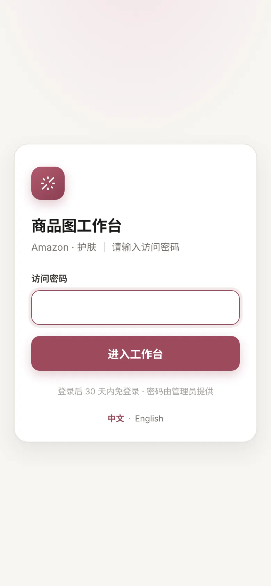

每个人用共享密码登录一次，30 天内免登录。然后选择**角色**（手机在右上角，电脑在左下角）。角色只决定能看到哪些页面，
是流程分工，不是账号权限（见 [SECURITY.md](../SECURITY.md)）。

| 角色 | 设备 | 页面 |
|---|---|---|
| 管理员 | 电脑 | 全部 + 设置 |
| 摄影 | 手机 | 任务单、拍摄上传 |
| 美工 | 电脑 | 任务单、画布、素材库 |
| 审核 | 手机 | 审核、素材库 |

---

## 1. 管理员：密码、模型通道、模板

### 1.1 访问密码

在 `.env` 里设置 `WB_ACCESS_PASSWORD`（第 0 步）并重启。改密码会让所有人重新登录。放在反向代理后面（nginx、Caddy、
Cloudflare Tunnel 等）时再设置 `WB_TRUST_PROXY=1`，用 HTTPS 时设置 `WB_COOKIE_SECURE=1`。

### 1.2 模型通道

**设置 → 模型通道**列出所有生图通道。开箱只启用了**模拟**（免费，占位背景，适合熟悉流程）和 **Grok 生图（外部导入）**
（免费，你自己在任意工具里出背景再导入）。

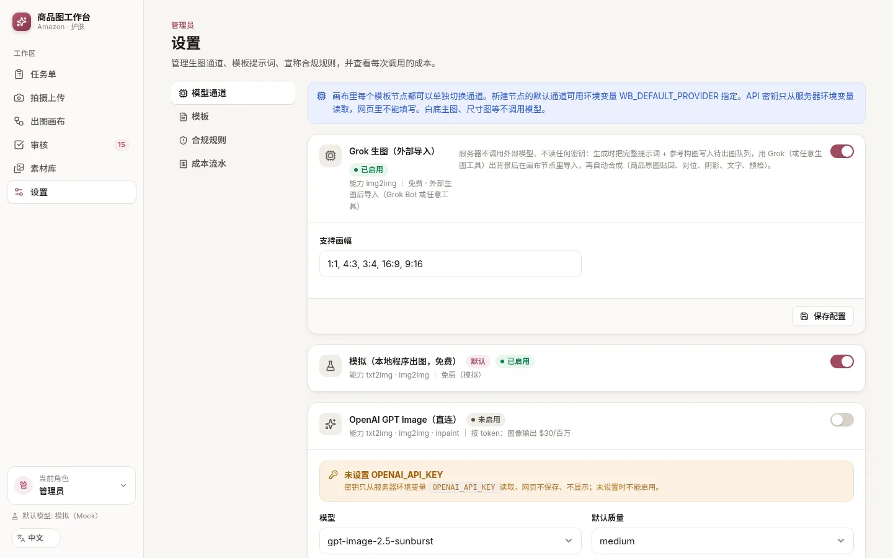

几条重要规则：

- **API 密钥永远不在网页里填写。**只在服务启动时从环境变量（`.env`）读取；没有密钥的付费通道无法启用。
- **新建**画布节点用的通道由 `WB_DEFAULT_PROVIDER` 决定（默认 `mock`）。美工可以把任意单个节点切换到其他已启用的通道。
- 纯白主图、尺寸图、包装内容图等版式不调用模型。

**用你自己的 key 接入 OpenAI**

1. 在 `.env` 里加：`OPENAI_API_KEY=sk-...`（可选：`OPENAI_BASE_URL=...` 指向兼容 OpenAI 的网关）。
2. 可选：`WB_DEFAULT_PROVIDER=openai`，让新节点默认用它。
3. 重启服务（重新 `npm start`；Docker 用 `docker compose up -d`）。
4. 设置 →「OpenAI GPT Image（直连）」会显示「已检测到 OPENAI_API_KEY」→ 打开开关，选模型和质量，**保存配置**。

每次调用都会记在**设置 → 成本流水**里（token 和美元）。

**本地 ComfyUI（自己的显卡，不按张付费）**

1. 在 ComfyUI 里开启 *Dev mode*，用 **Save (API Format)** 导出工作流。
2. 设置 →「本地 ComfyUI」：把 JSON 粘贴到「工作流 JSON」，填「接口地址」（默认 `http://127.0.0.1:8188`）。
3. 按 `节点ID.字段` 映射输入：「提示词节点」如 `6.text`（必填），「输入图节点」如 `10.image`（LoadImage 节点，参考构图图
   会上传给它），可选「遮罩节点」，「种子节点」如 `3.seed`。
4. 保存，打开开关，在画布节点上选择它（或设置 `WB_DEFAULT_PROVIDER=comfyui`）。

**任意其他生图 API（通用 HTTP，无需写代码）**

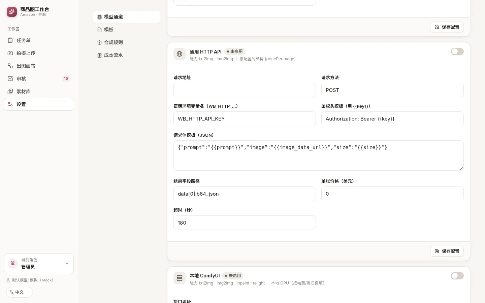

1. 把 key 写进 `.env`，变量名必须以 `WB_HTTP_` 开头，例如 `WB_HTTP_API_KEY=...`，然后重启。
2. 设置 →「通用 HTTP API」：填「请求地址」，「密钥环境变量名」保持 `WB_HTTP_API_KEY`，「鉴权头模板」写
   `Authorization: Bearer {{key}}`（写 `{{key}}`，不要写密钥本身）。
3. 「请求体模板」是要发送的 JSON，可用变量如 `{{prompt}}`、`{{image_data_url}}`、`{{size}}`；「结果字段路径」告诉系统
   图片在返回结果里的位置，例如 `data[0].b64_json` 或 `images[0].url`。
4. 保存、启用，在节点上使用。每个字段的说明见 [ADAPTERS.md](ADAPTERS.md)。

**Grok / 外部导入（免费，手动）**——服务器写好提示词和参考构图图，你在 Grok、ChatGPT、Midjourney 等工具里出背景再导入
（见 [3.4](#34-外部导入)）。

### 1.3 模板提示词和合规规则

**设置 → 模板**保存每个生成类模板的默认提示词，按段落拆分（用途、商品、场景与布景、机位、布光……）。修改对之后的新生成生效。
`{name}`、`{hero_ingredients}` 等 `{变量}` 会用款号资料自动填充——见 [PROMPTS.md](PROMPTS.md)。

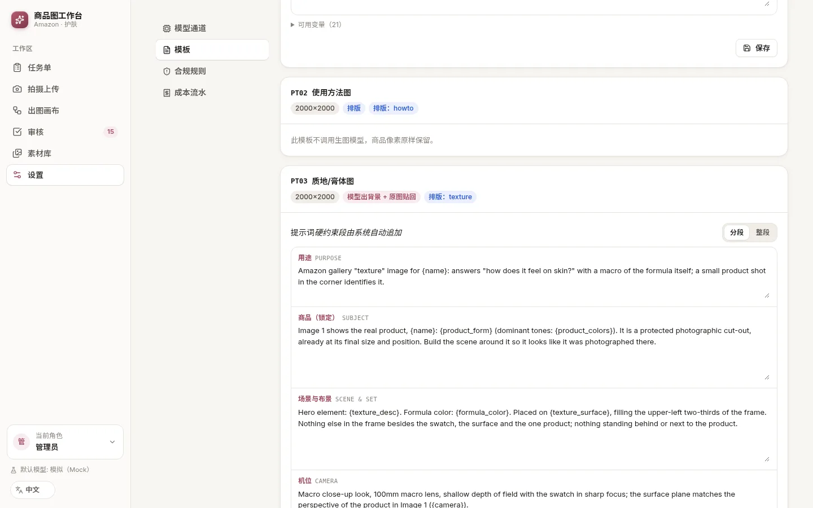

**设置 → 合规规则**列出预检使用的 FDA / 亚马逊宣称规则（只读；仅作提示，不是法律意见）。

---

## 2. 摄影：手机拍摄上传

### 2.1 任务单（管理员或美工创建）

在电脑上：**任务单 → 新建任务单**。必填**款号**和**英文品名**。填上 **ASIN**，导出时才会用亚马逊文件名。选好**必拍角度**，
并填写英文文案（成分、卖点、使用步骤、包装内容）——排版引擎会把它们放到图上，预检也会检查。

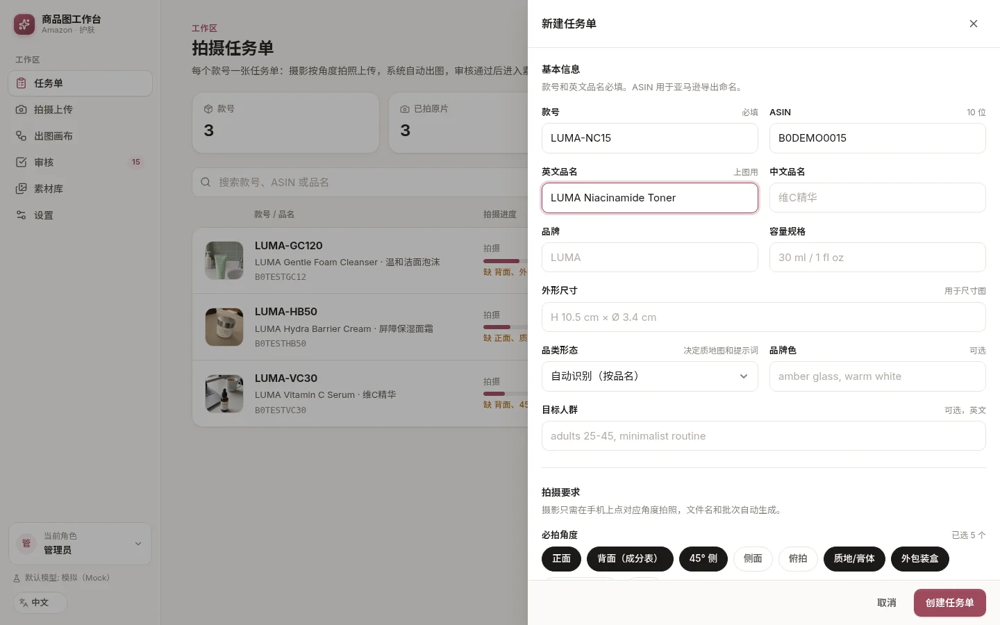

### 2.2 拍摄

1. 手机打开工作台，角色选**摄影** → **任务单** → 在某个款号上点**拍照上传**。
2. 每个格子是一个**角度槽位**。点格子直接调用相机，或点**相册**选已有照片。「必拍」是任务单要求的角度；底部的大按钮总会
   跳到下一个缺的角度。
3. 顶部圆环显示进度。照片下方会出现提示（分辨率低、偏暗、模糊），需要时请重拍。
4. **省流量模式**（网络慢时默认开启）：先传压缩图立刻开始出图，原图在后台补传。

| 任务单列表 | 角度槽位 |
|---|---|
| 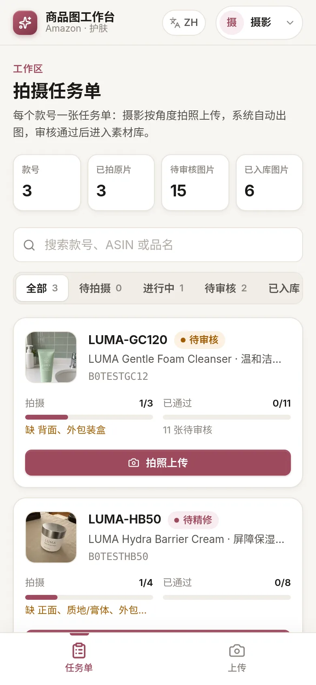 | 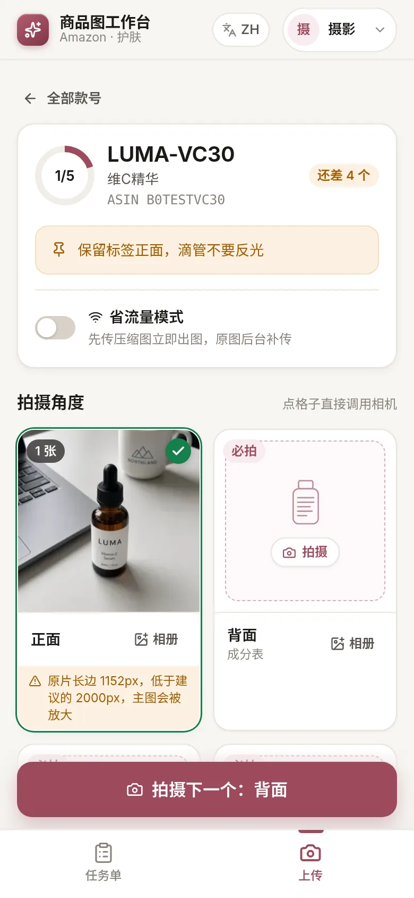 |

**批量上传**（电脑或手机）：文件命名为 `款号_角度_序号.jpg`，例如 `LUMA-VC30_front_01.jpg`、`LUMA-VC30_正面_1.jpg`
（角度：front / back / 45 / side / top / texture / package / inbox / detail，也可写正面、背面、质地、包装等）。认不出的文件
进入「待分拣」，手动选角度即可。原片会自动命名并只读归档。

照片一到，系统就自动抠图、铺好画布——摄影这边不需要再做别的。

---

## 3. 美工：在画布上精修

请用电脑（手机上不显示画布）。角色选**美工** → **画布** → 选择款号。

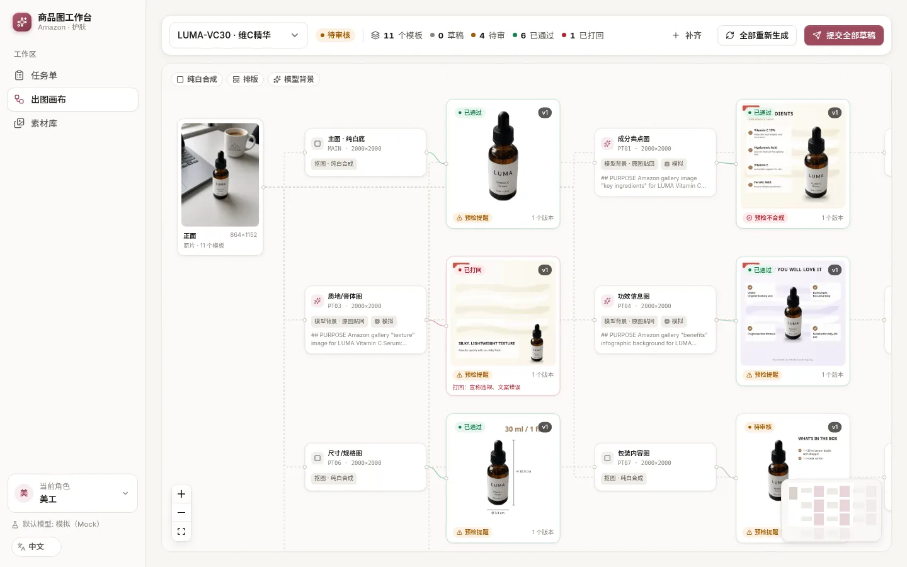

左边是原片；中间每个亚马逊图位一个**模板节点**（MAIN、PT01–PT07、A+）；右边是最新的**结果**，带状态和预检徽标。
节点可以随意拖动，位置会保存。图例对应三种类型：**纯白合成**（主图，不调模型）、**排版**（不调模型）、**模型背景**
（模型只画背景，真实商品逐像素贴回，所有文字由程序渲染）。

工具栏：**补齐**（为新上传的角度补上缺少的模板节点）、**全部重新生成**、**提交全部草稿**。

### 3.1 编辑节点

点击模板节点打开右侧面板：

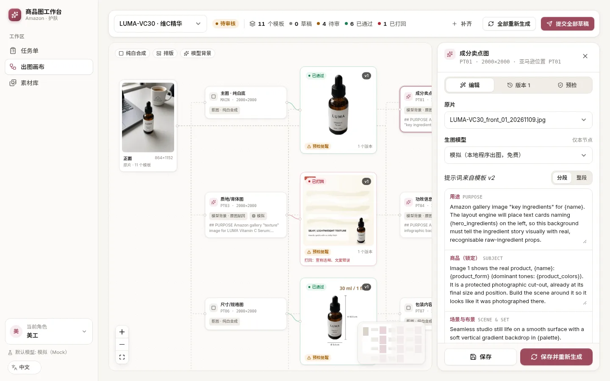

- **原片**——这个模板用哪张照片。
- **生图模型**——只对本节点生效的通道。
- **提示词**——按段落编辑（或切到「整段」）。这里的修改只覆盖本节点的模板；「实际发送给模型的完整提示词」展示变量填好后的
  最终文本。
- **色调 / 场景 / 质地 / 氛围 / 质量**——快捷覆盖，留空则自动推导。
- **画面文案**——标题、副标题和条目，由排版引擎叠加到图上。

**保存**只保存修改；**保存并重新生成**会生成一个新版本。

### 3.2 版本与预检

**版本**页列出所有版本（v1、v2……）及其状态、通道、耗时、实际使用的提示词和审核记录。**预检**页显示尺寸、可放大、文件大小、
四边纯白、85% 占比和宣称合规检查。

### 3.3 提交审核、处理打回

某个版本满意后：**版本 → 提交 vN 去审核**（或工具栏的**提交全部草稿**）。被打回的结果在画布上变红并显示审核原因：

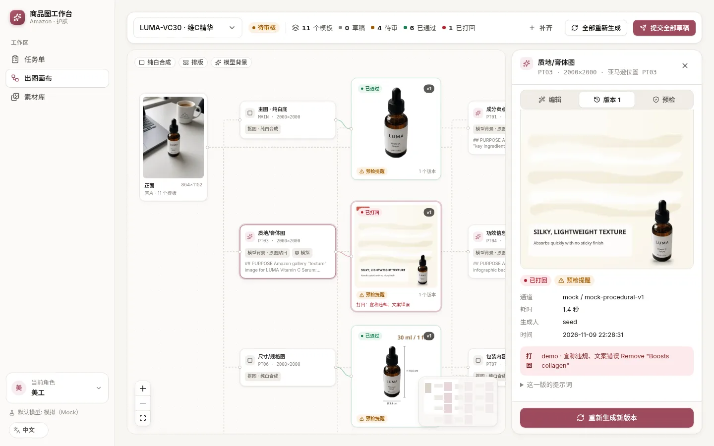

修改提示词或文案，**保存并重新生成**，再提交新版本。审核时会看到上一版做对比。

### 3.4 外部导入

如果节点用的是 **Grok 生图（外部导入）**，生成后会出现一个「待外部出图」的版本：

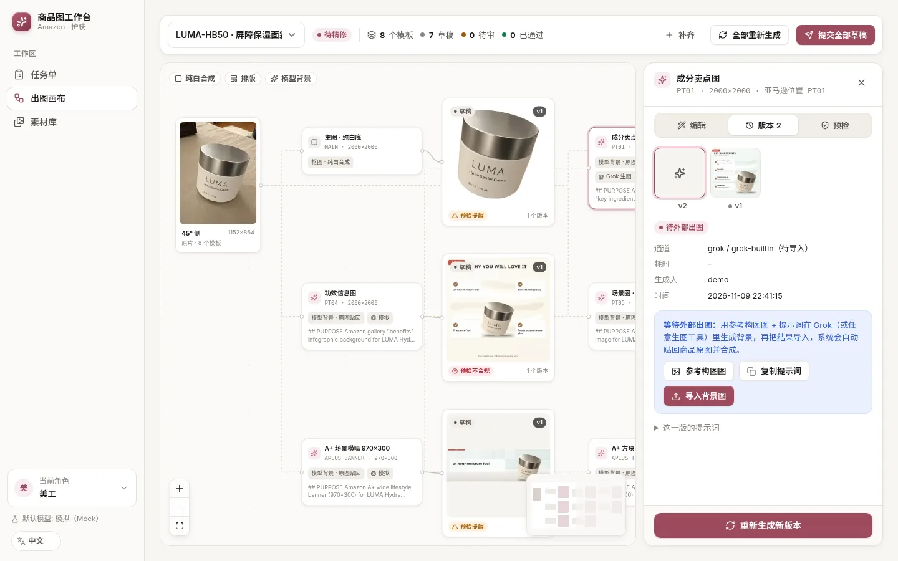

1. **参考构图图**——下载这张图，它标出了商品的位置。
2. **复制提示词**——连同参考图一起粘贴到 Grok、ChatGPT、Midjourney 等任意生图工具。
3. **导入背景图**——上传生成的图片。系统会自动裁切、贴回原图商品、对位、加阴影和文字，并跑预检。

（也可以用脚本：`POST /api/grok/import/<outputId>` 或 `python3 scripts/grok_jobs.py`。）

---

## 4. 审核：手机上通过或打回

角色选**审核** → **审核**。每张图一张卡片：

| 审核卡片 | 打回原因 |
|---|---|
| 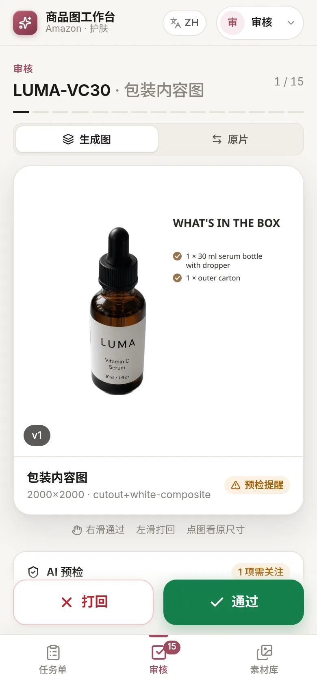 | 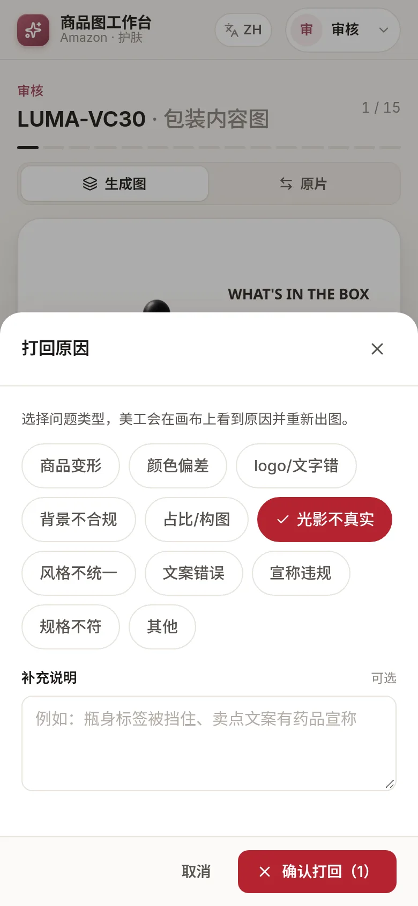 |

- **右滑**或点**通过**；**左滑**或点**打回**。
- 打回至少选一个**原因**（商品变形、颜色偏差、宣称违规……），可加补充说明。美工会在画布上看到。
- 在**生成图**、**原片**、（重新提交时）**上一版**之间切换对比；点图看原尺寸。
- **AI 预检**列出需要关注的项；预检有不合规项时点通过会再确认一次。
- **本款批量通过**会通过该款所有预检无不合规项的图。

---

## 5. 素材库：亚马逊导出

**素材库**只收审核通过的最终版本。

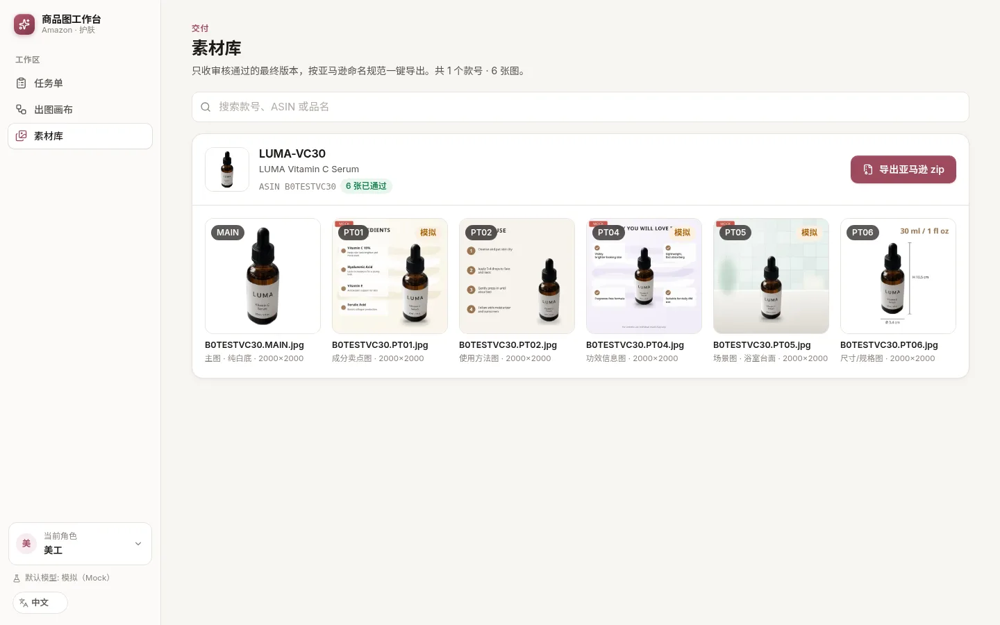

**导出亚马逊 zip** 一次下载整个款号，文件名符合 Seller Central 的要求：

```
B0XXXXXXXX.MAIN.jpg
B0XXXXXXXX.PT01.jpg … PT07.jpg
APLUS/B0XXXXXXXX.APLUS_HEADER_970x600.jpg
manifest.csv
```

没填 ASIN 时用款号代替，zip 里会附 `README_MISSING_ASIN.txt`——上传前请改名。也可以单张下载（手机上同样可用）。

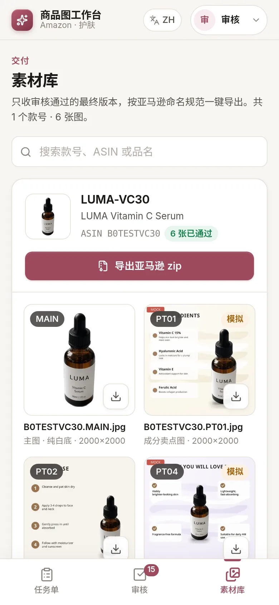

---

## 6. 常见问题与排错

**手机打不开。**
两台设备要在同一个网络（访客 Wi-Fi 通常会隔离设备）。用电脑的局域网 IP，不要用 `localhost`，并带上端口：
`http://192.168.x.x:5180`。在电脑防火墙里放行 Node.js（Windows 首次启动会弹窗询问；macOS：系统设置 → 网络 → 防火墙）。
`HOST` 保持 `0.0.0.0`（默认值）。Docker 部署请确认 5180 端口已映射（`docker compose ps`）。

**出图卡住（一直「生成中」）。**
打开节点的**版本**页：错误会显示在那里和服务器日志里。模拟通道几秒钟，付费模型 30–120 秒，ComfyUI 取决于显卡
（通道设置里的「超时（秒）」）。同时最多运行 `WB_CONCURRENCY`（默认 2）个任务，其余排队。服务重启时被中断的任务会标记为
失败——点**重新生成新版本**即可。「待外部出图」不是卡住，而是在等你导入背景（见 3.4）。

**API key 不生效。**
密钥只在启动时从环境变量读取：写进 `.env`（名称必须是 `OPENAI_API_KEY`、`FAL_KEY` 或 `WB_HTTP_…`）后**重启**
（`npm start`、`npm run dev`、`./start.sh` 和 Docker 都会读 `.env`；Docker 要执行 `docker compose up -d` 才会生效）。
服务器读到密钥后，设置页会显示「已检测到 …」。然后把通道**打开**，并在节点上选择它（或设置 `WB_DEFAULT_PROVIDER`）。
出于安全考虑，网页里不能填写密钥。

**图片尺寸 / 清晰度。**
拍摄时长边 ≥ 2000 px（低于这个上传时会提醒）；亚马逊放大功能要求 ≥ 1000 px。输出为 2000×2000（A+：970×600、
970×300、300×300），sRGB JPEG，预检会检查。单个文件上限 `WB_UPLOAD_MAX_MB`（默认 60 MB）。支持 JPEG、PNG、WebP、
TIFF、AVIF；HEIC 取决于服务器的 libvips——iPhone 照片上传失败时，把「设置 → 相机 → 格式」改成「兼容性最佳」。

**手机上看不到画布。**这是设计如此：画布需要大屏幕。手机上可以用拍摄上传、审核和素材库。

**数据在哪？**全部（SQLite 数据库、原片、生成图）都在 `WB_DATA_DIR`（默认 `./data`，Docker 为 `workbench-data` 卷）。
备份这个目录即可。

**其他问题？**欢迎提 [Issue](https://github.com/Bin0754/ecom-workbench/issues) 或到
[Discussions](https://github.com/Bin0754/ecom-workbench/discussions) 提问。
